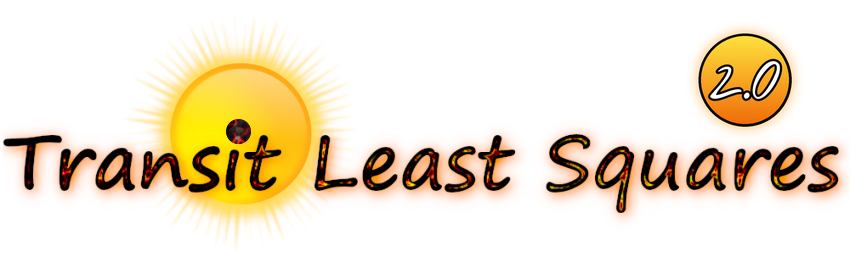
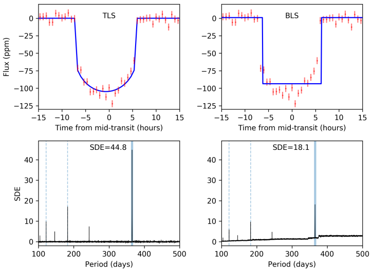
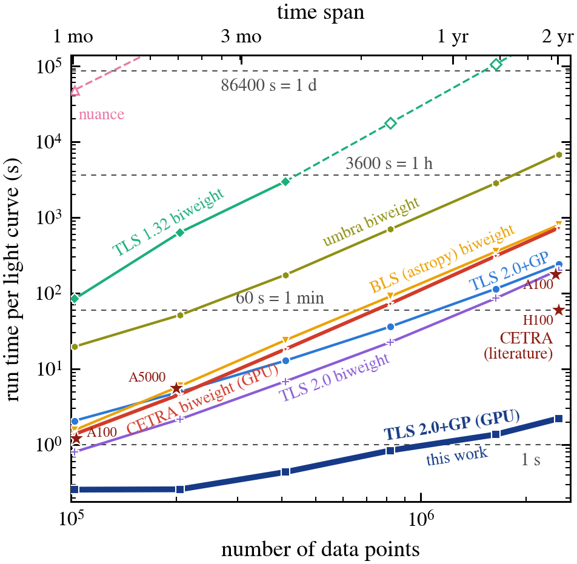

### An optimized transit-fitting algorithm to search for periodic transits of small planets
[](https://github.com/hippke/tls/blob/master/LICENSE)
[](https://pypi.org/project/transitleastsquares/)
[](https://pypi.org/project/transitleastsquares/)
[](https://transitleastsquares.readthedocs.io/en/latest/index.html)
[](https://github.com/hippke/tls/tree/master/tutorials)
[](https://arxiv.org/abs/1901.02015)


## Motivation
We present a new method to detect planetary transits from time-series photometry, the *Transit Least Squares* (TLS) algorithm. While the commonly used Box Least Squares [(BLS, Kovács et al. 2002)](http://adsabs.harvard.edu/abs/2002A%26A...391..369K) algorithm searches for rectangular signals in stellar light curves, *TLS* searches for transit-like features with stellar limb-darkening and including the effects of planetary ingress and egress. Moreover, *TLS* analyses the entire, unbinned data of the phase-folded light curve. These improvements yield a ~10 % higher detection efficiency (and similar false alarm rates) compared to BLS. The higher detection efficiency of our freely available Python implementation comes at the cost of higher computational load, which we partly compensate by applying an optimized period sampling and transit duration sampling, constrained to the physically plausible range. A typical Kepler K2 light curve, worth of 90 d of observations at a cadence of 30 min, can be searched with *TLS* in about half a second on a standard laptop computer (after a one-time JIT compilation of a few seconds) — as fast as BLS.



## What's new in TLS 2
* **Fast:** a two-year PLATO light curve at 25 s cadence (2.5 million points) is searched with simultaneous GP detrending in 4 min on a single CPU core, 25 s on 16 cores, or about 2 s on a consumer GPU (RTX 5060), including the hyperparameter fit and flare clipping. On the same data, biweight detrending followed by TLS 2.0 takes 3.4 min on one core and BLS 13 min; CETRA needs 12 min on the same GPU, `umbra` 1.9 h, TLS 1.32 about 3.5 d, and `nuance` years.

  

  *Run time per light curve against the number of data points, for a synthetic PLATO light curve from one month to two years at 25 s cadence, on one core of an AMD Ryzen 9 7950X and on an NVIDIA RTX 5060. Open markers and dashed lines are extrapolations; stars are published CETRA timings on other GPUs.*
* **Simultaneous GP detrending:** `from transitleastsquares import gp; results = gp.search(t, flux, flux_err)` models the star with a Gaussian process and integrates it out inside the search, instead of detrending first: every trial transit is fitted jointly with the stellar variability. It needs no detrending window and works on raw, normalised light curves.
* **GPU support**: `gp.search(..., device="gpu")` on an NVIDIA GPU (`pip install "transitleastsquares[gpu]"`), about 2 s per light curve even for two years of PLATO data.
* **Opt-in analytic SDE background** detrending: `power(SDE_detrend="hybrid")` (see the [documentation](https://transitleastsquares.readthedocs.io/en/latest/index.html)).
* Tutorials: [📑13 TLS with a GP baseline](https://github.com/hippke/tls/blob/master/tutorials/13%20TLS%20with%20a%20GP%20baseline%20-%20a%20spotted%20star%20with%20a%20planet.ipynb) (CPU and GPU) and [📑14 Reproducing the Talens et al. (2026) PLATO benchmark](https://github.com/hippke/tls/blob/master/tutorials/14%20Reproducing%20the%20Talens%20et%20al.%20(2026)%20PLATO%20benchmark.ipynb). Documentation: [GP search](https://transitleastsquares.readthedocs.io/en/latest/GP%20search.html).

See the [changelog](https://transitleastsquares.readthedocs.io/en/latest/Changelog.html) for the full list of changes.

## Installation

TLS can be installed conveniently using: `pip install transitleastsquares`

If you have multiple versions of Python and pip on your machine, try: `pip3 install transitleastsquares`

The latest version can be pulled from github:
```
git clone https://github.com/hippke/tls.git
cd tls
pip install .
```

For an editable (development) install, use `pip install -e .` instead of the last line.

For the GPU (NVIDIA, CUDA 13, driver 580 or later): `pip install "transitleastsquares[gpu]"`, or `pip install ".[gpu]"` in the cloned directory. For older drivers, install `numba-cuda[cu12]` instead.

Dependencies:
Python 3.9+ (tested up to 3.14),
[NumPy](http://www.numpy.org/) (>= 1.22),
[numba](http://numba.pydata.org/),
[tqdm](https://github.com/tqdm/tqdm),
optional:
[astroquery](https://astroquery.readthedocs.io/en/latest/) (for LD and stellar density priors from Kepler K1, K2, and TESS),
[batman-package](https://www.cfa.harvard.edu/~lkreidberg/batman/) (only needed to run the test suite).

If you have trouble installing, please [open an issue](https://github.com/hippke/tls/issues).


## Getting started
Here is a terminal recording of a real TLS 2.0 search: 231,000 trial periods on 8 CPU cores in about 6 seconds (3 years of simulated photometry of a solar-type star with an Earth-like planet). For more examples, have a look at the [tutorials](https://github.com/hippke/tls/tree/master/tutorials) and the [documentation](https://transitleastsquares.readthedocs.io/en/latest/index.html).
The [📑Grand Tour](https://github.com/hippke/tls/blob/master/tutorials/12%20The%20Grand%20Tour%20-%20from%20download%20to%20posterior.ipynb) goes from a raw TESS light curve to a planet's posterior: download with lightkurve, detrending with [wotan](https://github.com/hippke/wotan), the search with TLS, and the fit with [pizzetti](https://github.com/hippke/pizzetti).


## Attribution
Please cite [Hippke & Heller (2019, A&A 623, A39)](https://ui.adsabs.harvard.edu/#abs/2019A&A...623A..39H/abstract) if you find this code useful in your research. The BibTeX entry for the paper is:

```
@ARTICLE{2019A&A...623A..39H,
       author = {{Hippke}, Michael and {Heller}, Ren{\'e}},
        title = "{Optimized transit detection algorithm to search for periodic transits of small planets}",
      journal = {\aap},
         year = "2019",
        month = "Mar",
       volume = {623},
          eid = {A39},
        pages = {A39},
          doi = {10.1051/0004-6361/201834672},
archivePrefix = {arXiv},
       eprint = {1901.02015},
 primaryClass = {astro-ph.EP},
       adsurl = {https://ui.adsabs.harvard.edu/\#abs/2019A&A...623A..39H},
      adsnote = {Provided by the SAO/NASA Astrophysics Data System}
}
```

## Contributing
All my repositories embrace collaboration between humans and AI. Contributions are welcome, whether they are written by you, by an AI assistant, or by both together, and they will be handled promptly. Please open an [issue](https://github.com/hippke/tls/issues) or a pull request.

Copyright 2019-2026 Michael Hippke & René Heller.
